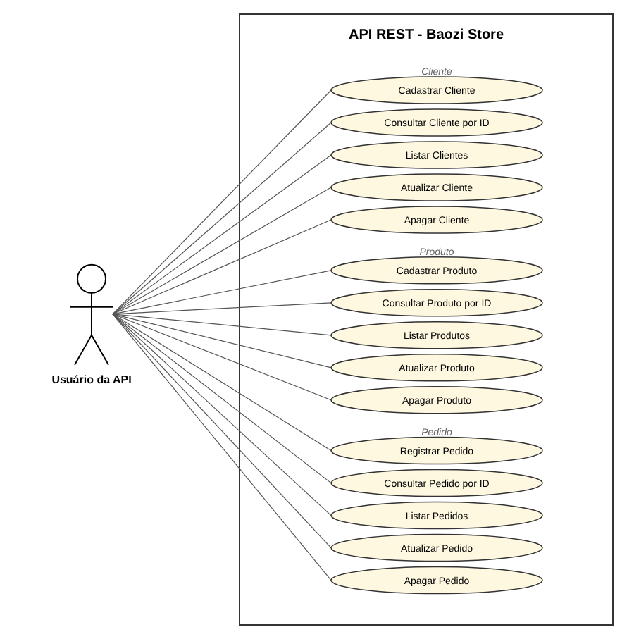

# Baozi Store - API REST

Trabalho da disciplina **Desenvolvimento Web Back-End** (UNINTER).

API REST simples para a Baozi Store, uma pequena loja que vende pão chinês (baozi).
A API permite cadastrar clientes, produtos e registrar pedidos.

## Tecnologias

- Java 17
- Spring Boot 3
- Spring Data JPA
- MySQL (ou H2 para testes)
- Maven
- Postman

## Estrutura do projeto

```
src/main/java/com/baozistore/api
├── BaoziStoreApplication.java
├── controller   -> ClienteController, ProdutoController, PedidoController
├── model        -> Cliente, Produto, Pedido
└── repository   -> ClienteRepository, ProdutoRepository, PedidoRepository
```

## Entidades

**Cliente**
| Campo | Tipo |
|---|---|
| id | Long |
| nome | String |
| clienteDesde | LocalDate |

**Produto**
| Campo | Tipo |
|---|---|
| id | Long |
| nome | String |
| preco | BigDecimal |
| estoque | Boolean |

**Pedido**
| Campo | Tipo |
|---|---|
| id | Long |
| cliente (cliente_id) | Cliente |
| produto (produto_id) | Produto |
| quantidade | Integer |

Um cliente pode ter vários pedidos e um produto pode estar em vários pedidos (`@ManyToOne`).

## Endpoints

| Método | URL | Descrição |
|---|---|---|
| POST | /clientes | cria um cliente |
| GET | /clientes | lista todos os clientes |
| GET | /clientes/{id} | busca cliente por id |
| PUT | /clientes/{id} | atualiza cliente |
| DELETE | /clientes/{id} | apaga cliente |
| POST | /produtos | cria um produto |
| GET | /produtos | lista todos os produtos |
| GET | /produtos/{id} | busca produto por id |
| PUT | /produtos/{id} | atualiza produto |
| DELETE | /produtos/{id} | apaga produto |
| POST | /pedidos | cria um pedido |
| GET | /pedidos | lista todos os pedidos |
| GET | /pedidos/{id} | busca pedido por id |
| PUT | /pedidos/{id} | atualiza a quantidade do pedido |
| DELETE | /pedidos/{id} | apaga pedido |

### Exemplos de JSON

Criar cliente:
```json
{ "nome": "Henrique1234567", "clienteDesde": "2026-10-19" }
```

Criar produto:
```json
{ "nome": "Baozi de porco", "preco": 8.50, "estoque": true }
```

Criar pedido:
```json
{ "cliente": { "id": 1 }, "produto": { "id": 1 }, "quantidade": 6 }
```

## Como rodar

### Com MySQL

1. Ter o MySQL rodando na porta 3306
2. Conferir usuário e senha em `src/main/resources/application.properties` (está `root` / `root`)
3. O banco `baozi_store` é criado automaticamente
4. Rodar:

```
mvn spring-boot:run
```

### Com H2 (sem instalar MySQL)

```
mvn spring-boot:run -Dspring-boot.run.profiles=h2
```

Console do H2: http://localhost:8080/h2-console (JDBC URL: `jdbc:h2:mem:baozi_store`, usuário `sa`, sem senha)

A API sobe em `http://localhost:8080`.

## Postman

A collection está em `docs/BaoziStore.postman_collection.json`. É só importar no Postman.

## Diagrama de caso de uso


